# Blur check: before / after (#22)

run 39818935764 on `agent/blur-fix` (commit `3447f3e`) · before = variance of the Laplacian of the whole 480 px frame < 60; after = worker `technical@0.2.0`: sharpness of the sharpest 25% of the textured tiles (luma std >= 8, ~60 px tiles), weakest of 4 directions, blurry below 30; a frame with no textured tile is not judged. The "after" constants were calibrated on scikit-image sample photos with synthetic blur, never on the clips below.

## Benchmark v2 synthetic slice (Egocentric-10K + synthetic defects)

40 originals, eval rubric (blurry frames at most 5%, bad exposure at most 10%).

Technical check (blur or exposure), every clip with a known technical label:

| rule | clips | false reject rate | false accept rate |
|---|---|---|---|
| before | 120 | 0.00 [0.00-0.04] (0/96) | 0.38 [0.21-0.57] (9/24) |
| after | 120 | 0.00 [0.00-0.04] (0/96) | 0.17 [0.07-0.36] (4/24) |

Blur alone:

| clips | should be | before: wrong | after: wrong |
|---|---|---|---|
| originals | sharp (false reject) | 0.00 [0.00-0.09] (0/40) | 0.00 [0.00-0.09] (0/40) |
| `blur` variants in the slice | blurry (false accept) | 0.88 [0.53-0.98] (7/8) | 0.25 [0.07-0.59] (2/8) |
| `blur` applied to every original | blurry (false accept) | 0.60 [0.45-0.74] (24/40) | 0.20 [0.10-0.35] (8/40) |

Other variants (exposure, overlays, duplicates, hand crops) called blurry: before 13/112, after 1/112 (not labelled for blur: the hand crops are zooms and do soften the frame).

## Pexels clips

Limit: blurry frames at most 10% (site-clips rubric). Every clip is sharp to the eye, so a "reject" is a false reject.

| clip | frames | before: blurry frames | before | after: blurry frames | after | frames without texture | median sharpness (after) |
|---|---|---|---|---|---|---|---|
| pexels_7658012 (Putting ground coffee in a filter) | 52 | 23% | **reject** | 0% | pass | 0% | 167 |
| pexels_6693828 (Crushing coffee with a pestle) | 117 | 0% | pass | 0% | pass | 0% | 282 |
| pexels_7308220 (Folding laundry) | 33 | 0% | pass | 0% | pass | 0% | 159 |
| pexels_4520150 (Packing jeans in a box) | 33 | 55% | **reject** | 9% | pass | 0% | 45 |
| pexels_11102752 (Cooking in a pot) | 35 | 9% | pass | 9% | pass | 0% | 239 |
| pexels_5592524 (Cleaning a countertop) | 68 | 0% | pass | 0% | pass | 0% | 352 |
| pexels_4440711 (Loading a washing machine) | 18 | 0% | pass | 0% | pass | 0% | 124 |
| pexels_7641501 (Washing cups) | 72 | 0% | pass | 0% | pass | 0% | 114 |
| pexels_9141844 (Putting folded clothes in a bag) | 57 | 21% | **reject** | 4% | pass | 0% | 65 |

## Frames

Plain tiles (no texture, ignored by the new measure) are shaded purple. Top line: the old measure; second line: the new one.

**pexels_7658012** (Putting ground coffee in a filter): before 23% blurry, after 0%

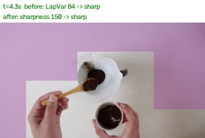 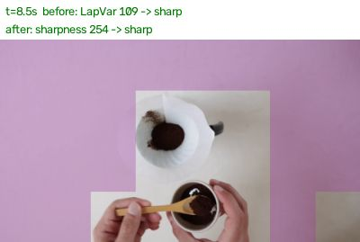 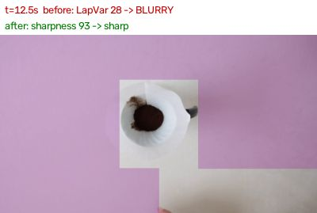 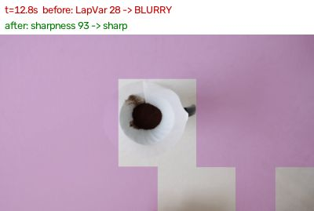

**pexels_6693828** (Crushing coffee with a pestle): before 0% blurry, after 0%

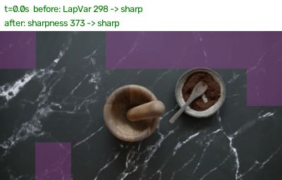 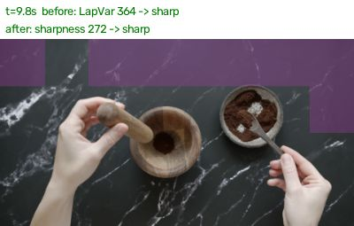 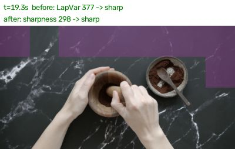 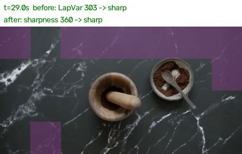

**pexels_7308220** (Folding laundry): before 0% blurry, after 0%

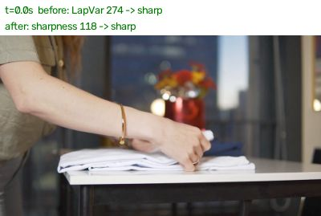 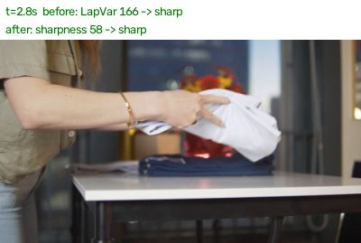 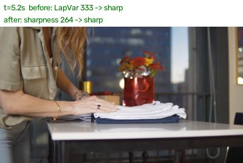 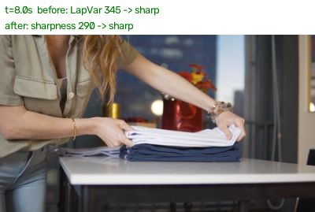

**pexels_4520150** (Packing jeans in a box): before 55% blurry, after 9%

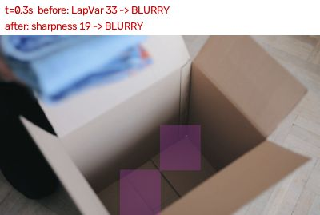 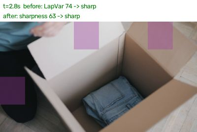 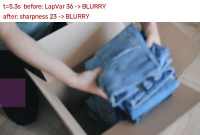 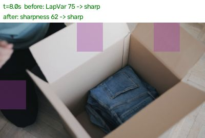

**pexels_11102752** (Cooking in a pot): before 9% blurry, after 9%

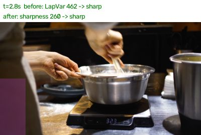 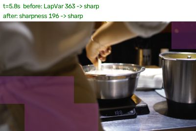 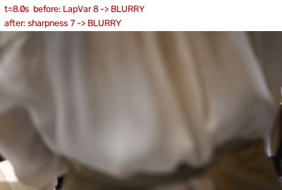 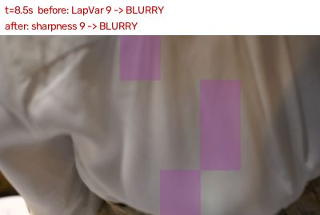

**pexels_5592524** (Cleaning a countertop): before 0% blurry, after 0%

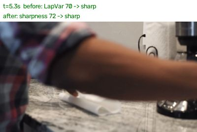 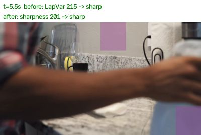 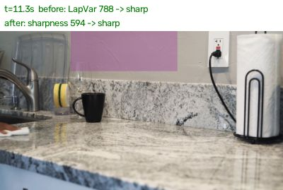 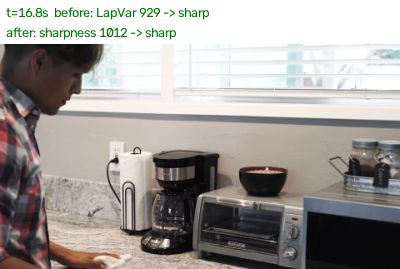

**pexels_4440711** (Loading a washing machine): before 0% blurry, after 0%

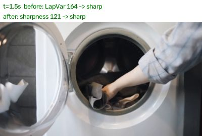 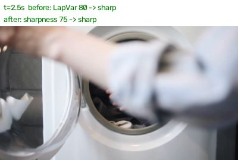 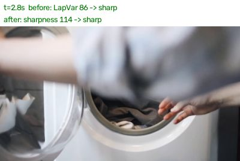 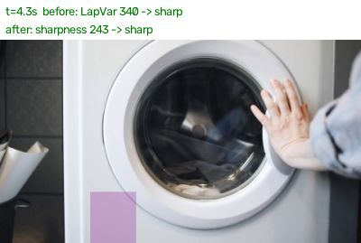

**pexels_7641501** (Washing cups): before 0% blurry, after 0%

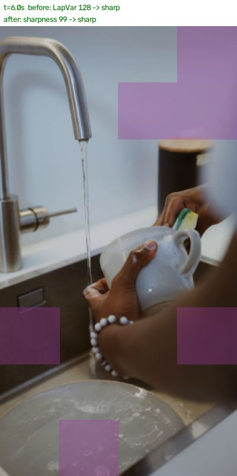 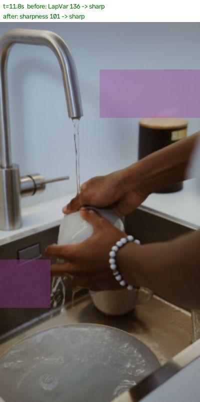 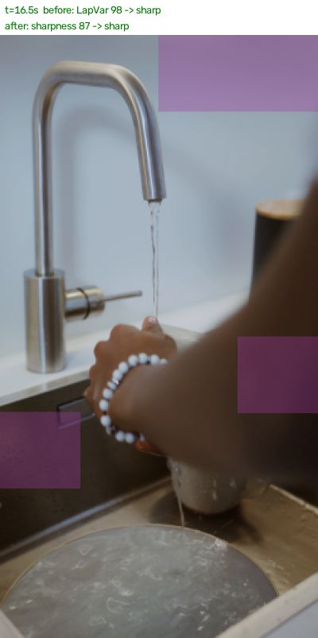 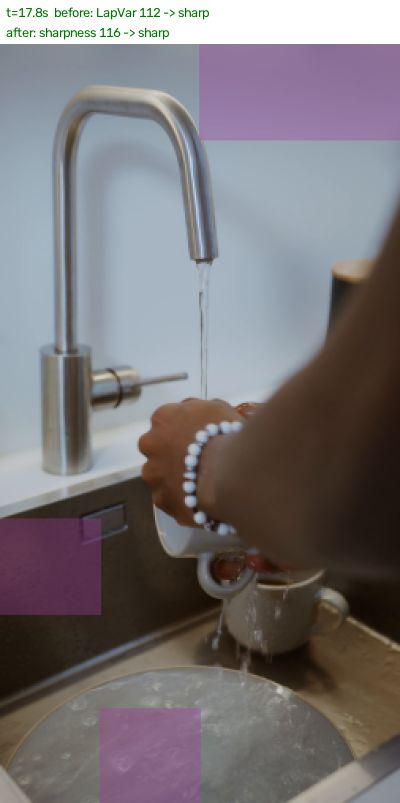

**pexels_9141844** (Putting folded clothes in a bag): before 21% blurry, after 4%

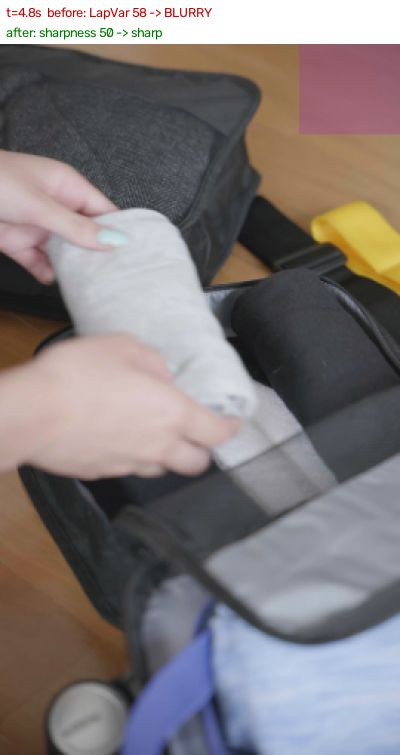 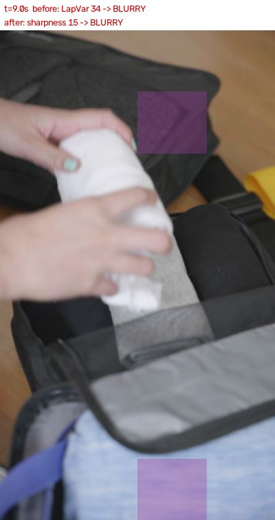 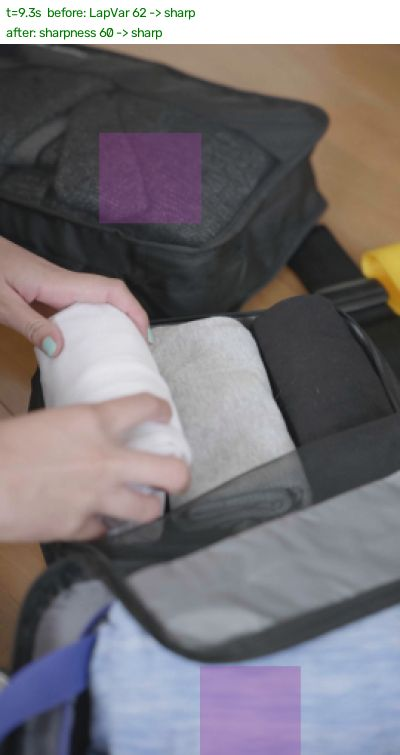 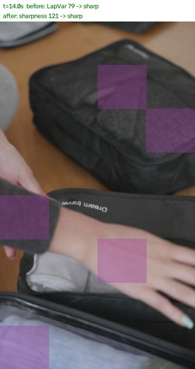

