# Privacy check: what the face detector sees (#83)

run 39924848669 on `agent/privacy-fix` (commit `b290422`) · the worker's own decode (frames at most 480 px, 4 fps, privacy looks at every 2nd frame) and YuNet (`face_detection_yunet_2023mar.onnx`). Worker rule today: a face is **confident** (reported, the rubric rejects or reviews) from score 0.8 and width 4% of the frame, **possible** (`faces_possible`, not used by the rubric) from 0.6 and 2%; either needs 2 hits within 2 s, anywhere in the frame. Raw detections below are everything YuNet returns from score 0.3.

| clip | frames analysed | worker `faces` | worker `faces_possible` | raw: confident | raw: possible | raw: below floor | best score |
|---|---|---|---|---|---|---|---|
| pexels_7204592 (Washing up in the sink) | 17 | 0 | 0 | 0 | 1 | 8 | 0.61 |
| pexels_7418650 (Making a salad) | 50 | 0 | 0 | 0 | 0 | 22 | 0.53 |
| pexels_37443407 (Whipping cream with an electric mixer) | 24 | 0 | 29 (first at 0.0 s) | 1 | 29 | 14 | 0.81 |
| pexels_7658012 (Putting ground coffee in a filter) | 26 | 0 | 0 | 0 | 0 | 0 | 0.00 |
| pexels_27917233 (Grinding coffee by hand) | 43 | 0 | 0 | 0 | 4 | 12 | 0.77 |
| pexels_6693828 (Crushing coffee with a pestle) | 59 | 3 (first at 0.0 s) | 28 (first at 4.0 s) | 3 | 29 | 21 | 0.86 |
| pexels_7308220 (Folding laundry) | 17 | 0 | 0 | 0 | 0 | 1 | 0.45 |
| pexels_4520150 (Packing jeans in a box) | 17 | 0 | 0 | 0 | 0 | 0 | 0.00 |
| pexels_11102752 (Cooking in a pot) | 18 | 0 | 0 | 1 | 1 | 5 | 0.81 |
| pexels_5592524 (Cleaning a countertop) | 34 | 2 (first at 16.0 s) | 0 | 2 | 0 | 3 | 0.89 |
| pexels_4440711 (Loading a washing machine) | 9 | 0 | 2 (first at 0.0 s) | 0 | 2 | 5 | 0.76 |
| pexels_7641501 (Washing cups) | 36 | 0 | 0 | 0 | 0 | 5 | 0.43 |
| pexels_9141844 (Putting folded clothes in a bag) | 29 | 0 | 0 | 0 | 0 | 3 | 0.41 |

## Frames

Boxes: red = confident (counts as a face), orange = possible, grey = below the worker's floor. Green dots = YuNet's five landmarks (eyes, nose tip, mouth corners). Under each frame: a zoom of the strongest boxes.

**pexels_7204592** (Washing up in the sink)

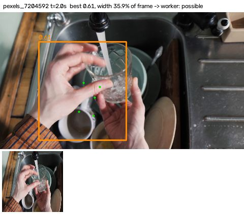
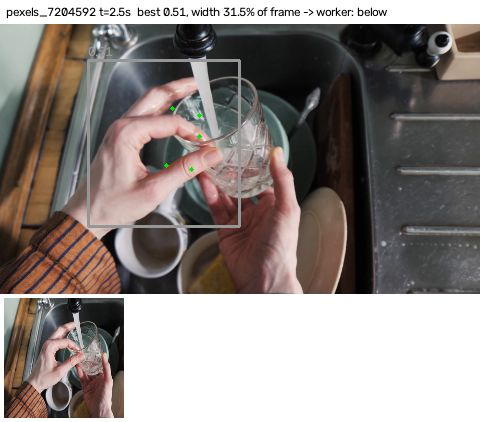

**pexels_7418650** (Making a salad)

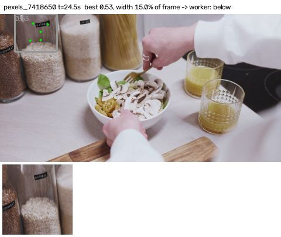

**pexels_37443407** (Whipping cream with an electric mixer)

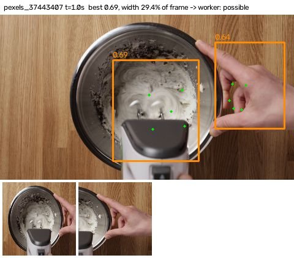
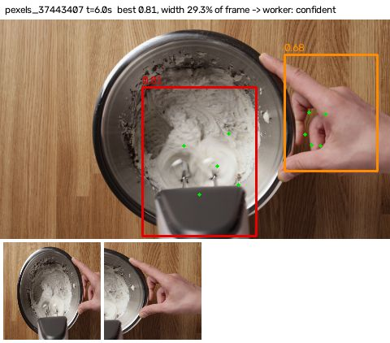
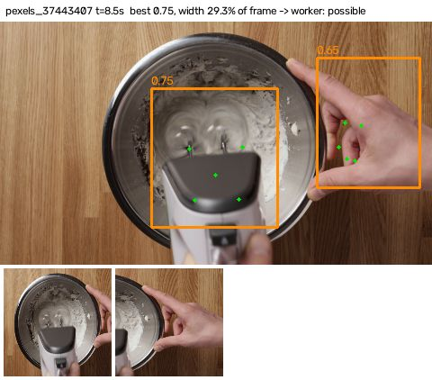
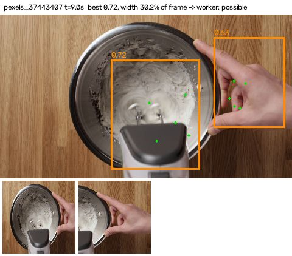

**pexels_27917233** (Grinding coffee by hand)

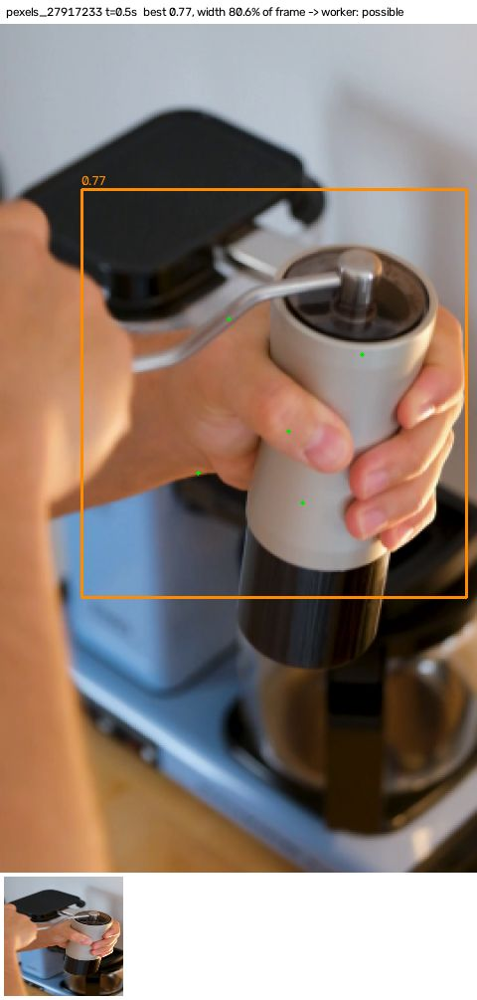
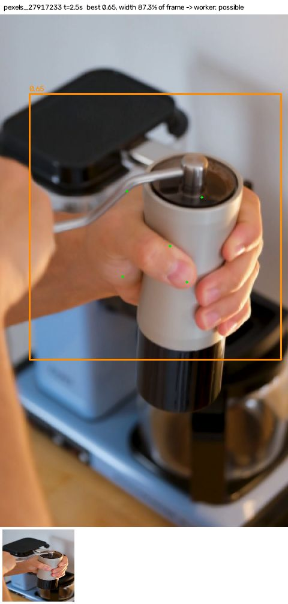
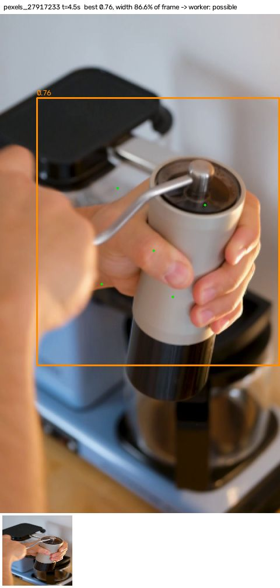
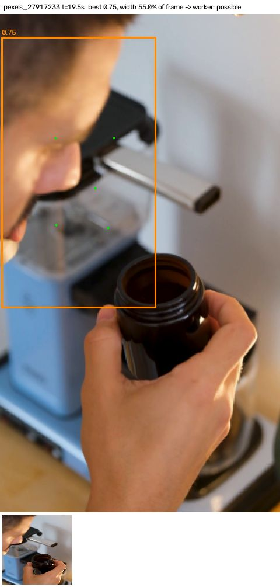

**pexels_6693828** (Crushing coffee with a pestle)

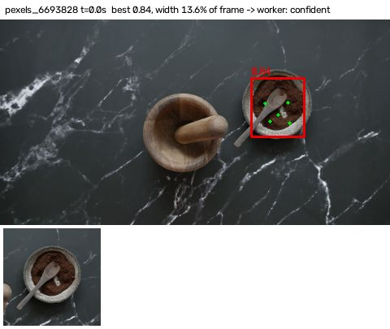
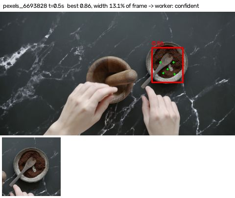
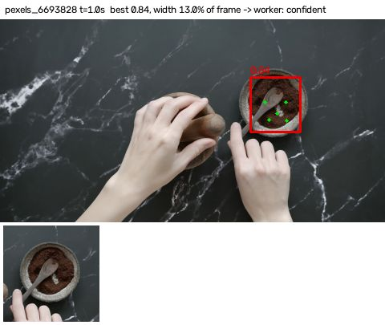
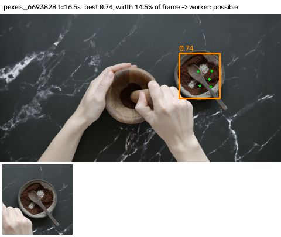

**pexels_11102752** (Cooking in a pot)

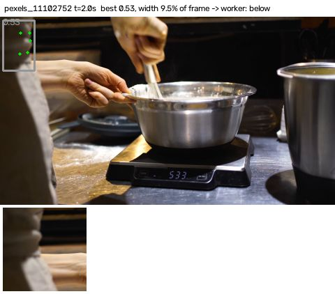
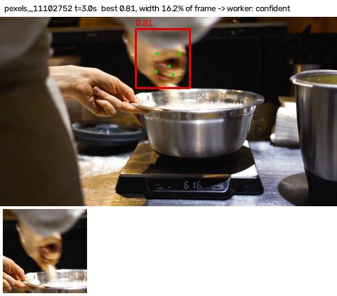
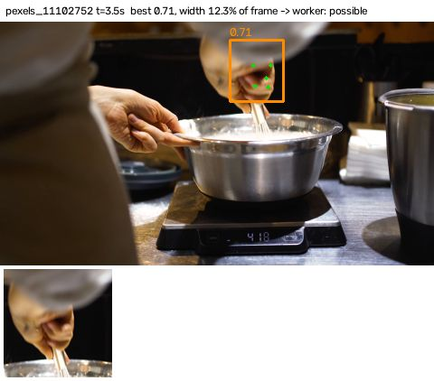

**pexels_5592524** (Cleaning a countertop)

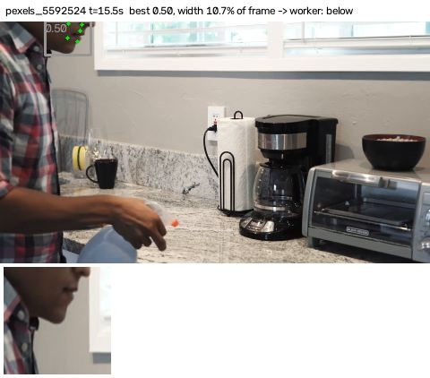
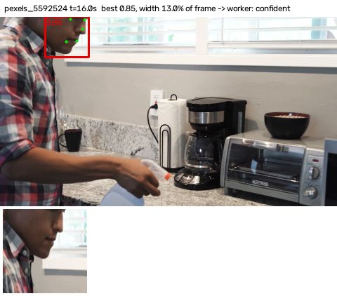
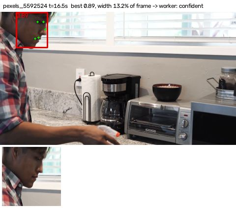

**pexels_4440711** (Loading a washing machine)

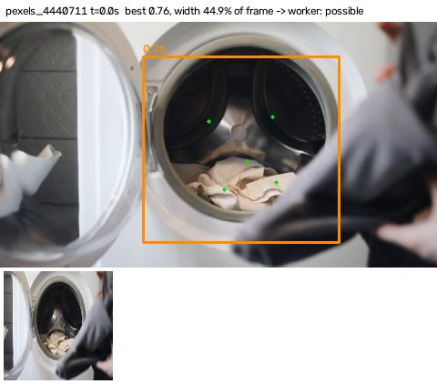
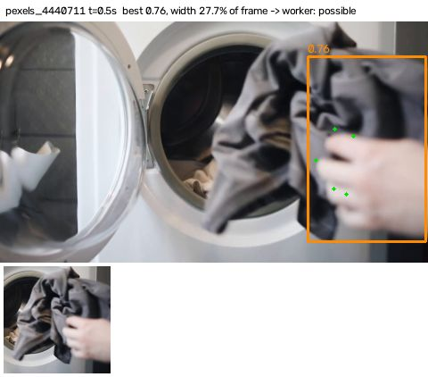
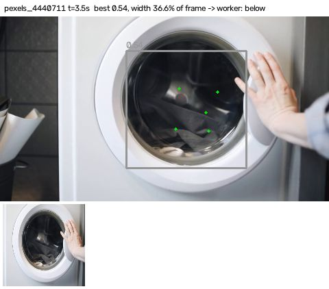
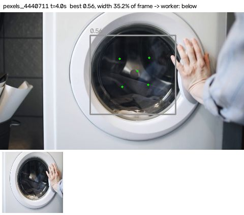

