# Viewpoint check (#79)

run 39857573586 on `agent/viewpoint` (commit `e3c3d17`) · worker `viewpoint@0.1.0` applied to the stored features. Labels come from the sources (head-mounted datasets, the founder's picks, Pexels clips labelled by eye with their contact sheets on #79), never from Ormes. Constants fitted on `dev` only.

**Before:** Ormes had no viewpoint check: every third-person video went through as if first-person (third-person caught: 0%).

| split | first-person clips | called third-person (costly error) | uncertain (review) | third-person clips | called first-person (missed) | uncertain (review) | caught |
|---|---|---|---|---|---|---|---|
| dev | 65 | 0.00 [0.00-0.06] (0/65) | 0.15 [0.09-0.26] (10/65) | 3 | 0.33 [0.06-0.79] (1/3) | 0.67 [0.21-0.94] (2/3) | 0.00 [0.00-0.56] (0/3) |
| held_out | 26 | 0.00 [0.00-0.13] (0/26) | 0.04 [0.01-0.19] (1/26) | 4 | 0.00 [0.00-0.49] (0/4) | 0.00 [0.00-0.49] (0/4) | 1.00 [0.51-1.00] (4/4) |
| dev + held_out | 91 | 0.00 [0.00-0.04] (0/91) | 0.12 [0.07-0.20] (11/91) | 7 | 0.14 [0.03-0.51] (1/7) | 0.29 [0.08-0.64] (2/7) | 0.57 [0.25-0.84] (4/7) |

By source (all splits):

| source | label | clips | first-person | uncertain | third-person |
|---|---|---|---|---|---|
| egocentric10k | first_person | 60 | 51 | 9 | 0 |
| holoassist | first_person | 27 | 27 | 0 | 0 |
| pexels | first_person | 4 | 2 | 2 | 0 |
| pexels | third_person | 7 | 1 | 2 | 4 |

Every labelled clip:

| clip | split | label | verdict | first_person_ratio | hand frames | pointing up (median) | hand scale | face share | still share |
|---|---|---|---|---|---|---|---|---|---|
| ego10k_factory001_worker001_00000 | dev | first_person | first_person | 0.938 | 16 | 0.983 | 0.16 | 0.0 | 0.013 |
| ego10k_factory001_worker001_00001 | dev | first_person | first_person | 0.944 | 18 | 0.985 | 0.151 | 0.0 | 0.0 |
| ego10k_factory002_worker001_00000 | dev | first_person | first_person | 0.974 | 39 | 0.961 | 0.171 | 0.0 | 0.038 |
| ego10k_factory003_worker001_00000 | dev | first_person | first_person | 0.971 | 35 | 0.919 | 0.173 | 0.0 | 0.038 |
| ego10k_factory004_worker001_00000 | dev | first_person | first_person | 0.964 | 56 | 0.972 | 0.239 | 0.0 | 0.025 |
| ego10k_factory005_worker001_00000 | dev | first_person | uncertain | 0.333 | 3 | -0.093 | 0.057 | 0.0 | 0.0 |
| ego10k_factory006_worker001_00000 | dev | first_person | uncertain | 0.75 | 4 | 0.636 | 0.139 | 0.0 | 0.026 |
| ego10k_factory007_worker001_00000 | dev | first_person | first_person | 0.981 | 54 | 0.975 | 0.157 | 0.0 | 0.014 |
| ego10k_factory008_worker001_00000 | dev | first_person | first_person | 0.958 | 48 | 0.958 | 0.144 | 0.0 | 0.138 |
| ego10k_factory009_worker001_00000 | held_out | first_person | first_person | 0.917 | 12 | 0.804 | 0.129 | 0.0 | 0.025 |
| ego10k_factory010_worker001_00001 | dev | first_person | uncertain | 1.0 | 2 | 0.993 | 0.11 | 0.05 | 0.0 |
| ego10k_factory010_worker001_00003 | dev | first_person | first_person | 1.0 | 48 | 0.862 | 0.18 | 0.0 | 0.113 |
| ego10k_factory011_worker001_00001 | dev | first_person | first_person | 1.0 | 28 | 0.993 | 0.173 | 0.0 | 0.013 |
| ego10k_factory011_worker001_00002 | dev | first_person | first_person | 1.0 | 40 | 0.983 | 0.152 | 0.0 | 0.025 |
| ego10k_factory012_worker001_00003 | held_out | first_person | first_person | 0.987 | 77 | 0.974 | 0.209 | 0.0 | 0.138 |
| ego10k_factory012_worker001_00009 | held_out | first_person | first_person | 0.947 | 75 | 0.911 | 0.213 | 0.0 | 0.212 |
| ego10k_factory013_worker001_00006 | held_out | first_person | first_person | 1.0 | 51 | 0.845 | 0.251 | 0.0 | 0.064 |
| ego10k_factory013_worker001_00008 | held_out | first_person | first_person | 1.0 | 42 | 0.862 | 0.265 | 0.0 | 0.026 |
| ego10k_factory014_worker001_00000 | held_out | first_person | first_person | 0.932 | 44 | 0.896 | 0.166 | 0.0 | 0.256 |
| ego10k_factory014_worker001_00007 | held_out | first_person | first_person | 1.0 | 71 | 0.947 | 0.192 | 0.0 | 0.0 |
| ego10k_factory015_worker001_00000 | dev | first_person | first_person | 0.72 | 50 | 0.583 | 0.213 | 0.0 | 0.215 |
| ego10k_factory015_worker001_00006 | dev | first_person | first_person | 0.944 | 54 | 0.966 | 0.252 | 0.0 | 0.177 |
| ego10k_factory016_worker001_00000 | held_out | first_person | first_person | 1.0 | 18 | 0.89 | 0.157 | 0.0 | 0.0 |
| ego10k_factory017_worker001_00001 | held_out | first_person | first_person | 0.935 | 62 | 0.94 | 0.239 | 0.0 | 0.0 |
| ego10k_factory017_worker001_00002 | held_out | first_person | first_person | 0.88 | 50 | 0.867 | 0.208 | 0.0 | 0.1 |
| ego10k_factory018_worker001_00001 | dev | first_person | first_person | 1.0 | 53 | 0.962 | 0.217 | 0.0 | 0.113 |
| ego10k_factory018_worker001_00002 | dev | first_person | first_person | 1.0 | 45 | 0.926 | 0.209 | 0.0 | 0.013 |
| ego10k_factory019_worker001_00005 | dev | first_person | uncertain | 0.0 | 17 | -0.889 | 0.132 | 0.0 | 0.775 |
| ego10k_factory019_worker001_00006 | dev | first_person | uncertain | 0.0 | 32 | -0.921 | 0.106 | 0.0 | 0.887 |
| ego10k_factory020_worker001_00000 | dev | first_person | first_person | 1.0 | 44 | 0.884 | 0.18 | 0.0 | 0.039 |
| ego10k_factory020_worker001_00004 | dev | first_person | first_person | 1.0 | 71 | 0.947 | 0.181 | 0.0 | 0.062 |
| ego10k_factory021_worker001_00005 | dev | first_person | first_person | 1.0 | 58 | 0.918 | 0.257 | 0.0 | 0.113 |
| ego10k_factory021_worker001_00009 | dev | first_person | first_person | 0.976 | 41 | 0.952 | 0.148 | 0.0 | 0.038 |
| ego10k_factory022_worker001_00001 | dev | first_person | first_person | 0.981 | 54 | 0.939 | 0.202 | 0.0 | 0.0 |
| ego10k_factory022_worker001_00004 | dev | first_person | first_person | 0.986 | 69 | 0.897 | 0.181 | 0.0 | 0.013 |
| ego10k_factory023_worker001_00001 | dev | first_person | first_person | 1.0 | 77 | 0.975 | 0.215 | 0.0 | 0.138 |
| ego10k_factory023_worker001_00002 | dev | first_person | first_person | 1.0 | 75 | 0.963 | 0.215 | 0.0 | 0.138 |
| ego10k_factory024_worker001_00002 | dev | first_person | uncertain | 0.75 | 4 | 0.641 | 0.187 | 0.0 | 0.0 |
| ego10k_factory024_worker001_00006 | dev | first_person | first_person | 0.984 | 62 | 0.885 | 0.235 | 0.0 | 0.025 |
| ego10k_factory025_worker001_00001 | held_out | first_person | first_person | 1.0 | 65 | 0.867 | 0.251 | 0.0 | 0.138 |
| ego10k_factory025_worker001_00007 | held_out | first_person | first_person | 1.0 | 62 | 0.951 | 0.26 | 0.0 | 0.25 |
| ego10k_factory026_worker001_00000 | dev | first_person | first_person | 1.0 | 24 | 0.891 | 0.13 | 0.0 | 0.013 |
| ego10k_factory026_worker001_00003 | dev | first_person | first_person | 0.941 | 17 | 0.882 | 0.129 | 0.0 | 0.013 |
| ego10k_factory027_worker001_00000 | dev | first_person | first_person | 0.95 | 20 | 0.898 | 0.168 | 0.0 | 0.0 |
| ego10k_factory027_worker001_00006 | dev | first_person | first_person | 1.0 | 59 | 0.758 | 0.208 | 0.0 | 0.295 |
| ego10k_factory028_worker001_00003 | dev | first_person | first_person | 1.0 | 60 | 0.962 | 0.125 | 0.0 | 0.062 |
| ego10k_factory028_worker001_00008 | dev | first_person | first_person | 1.0 | 41 | 0.96 | 0.142 | 0.0 | 0.013 |
| ego10k_factory029_worker001_00000 | held_out | first_person | first_person | 1.0 | 21 | 0.962 | 0.19 | 0.0 | 0.0 |
| ego10k_factory029_worker001_00004 | held_out | first_person | first_person | 0.962 | 52 | 0.976 | 0.176 | 0.0 | 0.013 |
| ego10k_factory030_worker001_00001 | dev | first_person | uncertain | 0.6 | 5 | 0.852 | 0.07 | 0.0 | 0.025 |
| ego10k_factory030_worker001_00004 | dev | first_person | first_person | 0.786 | 14 | 0.865 | 0.074 | 0.0 | 0.125 |
| ego10k_factory031_worker001_00000 | dev | first_person | first_person | 0.964 | 56 | 0.677 | 0.228 | 0.0 | 0.0 |
| ego10k_factory031_worker001_00001 | dev | first_person | first_person | 1.0 | 65 | 0.674 | 0.217 | 0.0 | 0.0 |
| ego10k_factory032_worker001_00002 | dev | first_person | first_person | 0.957 | 23 | 0.86 | 0.074 | 0.0 | 0.41 |
| ego10k_factory032_worker001_00003 | dev | first_person | uncertain | 0.6 | 5 | 0.696 | 0.064 | 0.05 | 0.241 |
| ego10k_factory033_worker001_00000 | held_out | first_person | first_person | 1.0 | 65 | 0.807 | 0.193 | 0.0 | 0.188 |
| ego10k_factory033_worker001_00002 | held_out | first_person | first_person | 1.0 | 78 | 0.809 | 0.209 | 0.0 | 0.212 |
| ego10k_factory034_worker001_00000 | dev | first_person | uncertain | 0.625 | 8 | 0.46 | 0.102 | 0.25 | 0.354 |
| ego10k_factory034_worker001_00002 | dev | first_person | first_person | 0.895 | 19 | 0.922 | 0.126 | 0.0 | 0.025 |
| ego10k_factory035_worker001_00006 | dev | first_person | first_person | 1.0 | 66 | 0.931 | 0.166 | 0.0 | 0.087 |
| holo_R077-21July-Nespresso | dev | first_person | first_person | 1.0 | 49 | 0.844 | 0.277 | 0.0 | 0.025 |
| holo_R089-27July-Coffee | dev | first_person | first_person | 0.955 | 22 | 0.887 | 0.381 | 0.0 | 0.025 |
| holo_R100-1Aug-Coffee | held_out | first_person | first_person | 0.974 | 39 | 0.966 | 0.241 | 0.0 | 0.087 |
| holo_R190-24Oct-ATV | held_out | first_person | first_person | 1.0 | 8 | 0.78 | 0.256 | 0.0 | 0.051 |
| holo_R196-25Oct-RAM | dev | first_person | first_person | 1.0 | 6 | 0.963 | 0.259 | 0.0 | 0.013 |
| holo_R201-7Nov-Belt | held_out | first_person | first_person | 0.909 | 11 | 0.946 | 0.225 | 0.0 | 0.013 |
| holo_z023-june-21-22-gladom_disassemble | dev | first_person | first_person | 0.97 | 66 | 0.901 | 0.248 | 0.0 | 0.063 |
| holo_z034-june-23-22-espresso | dev | first_person | first_person | 1.0 | 56 | 0.972 | 0.255 | 0.0 | 0.087 |
| holo_z035-june-23-22-gopro | held_out | first_person | first_person | 1.0 | 50 | 0.819 | 0.357 | 0.0 | 0.025 |
| holo_z035-june-23-22-marius_assemble | dev | first_person | first_person | 1.0 | 77 | 0.868 | 0.257 | 0.0 | 0.125 |
| holo_z036-june-23-22-knarrevik_assemble | dev | first_person | first_person | 0.962 | 52 | 0.973 | 0.282 | 0.0 | 0.037 |
| holo_z075-july-01-22-marius_disassemble | dev | first_person | first_person | 1.0 | 69 | 0.934 | 0.224 | 0.0 | 0.101 |
| holo_z090-july-08-22-espresso | held_out | first_person | first_person | 1.0 | 52 | 0.981 | 0.242 | 0.0 | 0.0 |
| holo_z092-july-11-22-knarrevik_disassemble | dev | first_person | first_person | 1.0 | 60 | 0.943 | 0.418 | 0.0 | 0.013 |
| holo_z093-july-11-22-knarrevik_assemble | held_out | first_person | first_person | 1.0 | 70 | 0.933 | 0.288 | 0.0 | 0.101 |
| holo_z096-july-12-22-knarrevik_disassemble | held_out | first_person | first_person | 1.0 | 60 | 0.926 | 0.228 | 0.0 | 0.037 |
| holo_z103-july-14-22-dslr | dev | first_person | first_person | 1.0 | 55 | 0.815 | 0.284 | 0.0 | 0.025 |
| holo_z125-aug-10-22-printer_big | dev | first_person | first_person | 1.0 | 37 | 0.935 | 0.203 | 0.0 | 0.0 |
| holo_z127-aug-10-22-switch | dev | first_person | first_person | 1.0 | 62 | 0.97 | 0.276 | 0.0 | 0.025 |
| holo_z155-aug-26-22-dslr | dev | first_person | first_person | 0.944 | 71 | 0.947 | 0.238 | 0.0 | 0.076 |
| holo_z155-aug-26-22-rashult_disassemble | dev | first_person | first_person | 0.98 | 49 | 0.903 | 0.196 | 0.0 | 0.0 |
| holo_z170-sep-03-22-gladom_disassemble | dev | first_person | first_person | 1.0 | 58 | 0.87 | 0.298 | 0.0 | 0.037 |
| holo_z179-sep-06-22-gopro | dev | first_person | first_person | 1.0 | 80 | 0.973 | 0.284 | 0.0 | 0.05 |
| holo_z197-sep-18-22-gladom_assemble | held_out | first_person | first_person | 1.0 | 54 | 0.899 | 0.301 | 0.0 | 0.037 |
| holo_z201-sep-22-22-rashult_assemble | dev | first_person | first_person | 0.727 | 22 | 0.568 | 0.328 | 0.0 | 0.026 |
| holo_z202-sep-23-22-gladom_assemble | dev | first_person | first_person | 0.9 | 10 | 0.82 | 0.388 | 0.0 | 0.0 |
| holo_z204-sep-25-22-printer_small | dev | first_person | first_person | 0.833 | 18 | 0.938 | 0.192 | 0.0 | 0.141 |
| pexels_37443407 | dev | first_person | first_person | 1.0 | 48 | 0.744 | 0.348 | 0.0 | 0.562 |
| pexels_7204592 | held_out | first_person | first_person | 1.0 | 27 | 0.901 | 0.311 | 0.0 | 0.118 |
| pexels_7418650 | dev | first_person | uncertain | 0.439 | 82 | 0.416 | 0.297 | 0.0 | 0.273 |
| pexels_7658012 | held_out | first_person | uncertain | 1.0 | 2 | 0.891 | 0.091 | 0.0 | 0.712 |
| pexels_11102752 | held_out | third_person | third_person | 0.0 | 10 | -0.587 | 0.145 | 0.0 | 0.091 |
| pexels_4440711 | dev | third_person | first_person **x** | 0.7 | 10 | 0.87 | 0.199 | 0.0 | 0.444 |
| pexels_4520150 | dev | third_person | uncertain | 0.0 | 24 | -0.886 | 0.153 | 0.0 | 0.438 |
| pexels_5592524 | held_out | third_person | third_person | 0.045 | 44 | -0.282 | 0.233 | 0.059 | 0.03 |
| pexels_7308220 | held_out | third_person | third_person | 0.03 | 33 | -0.304 | 0.142 | 0.0 | 0.364 |
| pexels_7641501 | held_out | third_person | third_person | 0.276 | 29 | 0.026 | 0.11 | 0.0 | 0.069 |
| pexels_9141844 | dev | third_person | uncertain | 0.37 | 46 | 0.045 | 0.154 | 0.0 | 0.071 |

## Overlays

Green arrow: a hand pointing up the frame (wrist -> middle knuckle); red: not. Faces the privacy check keeps are boxed.

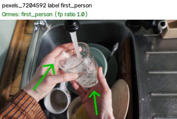
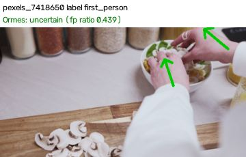
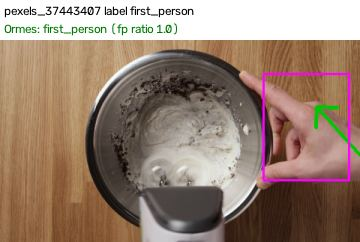
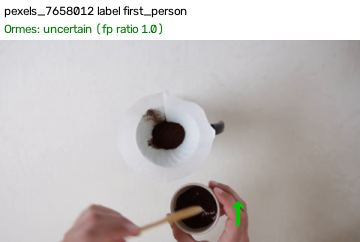
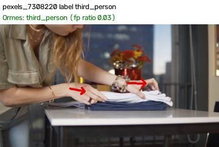
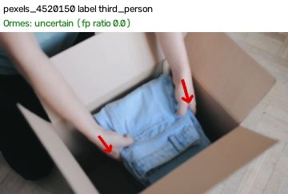
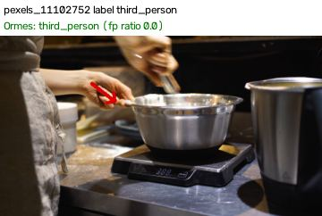
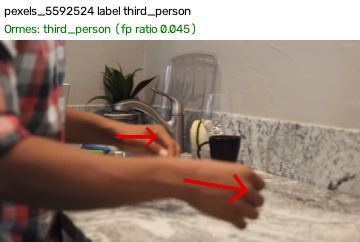
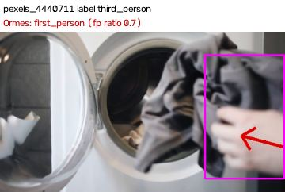
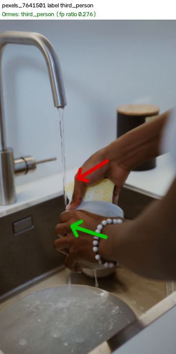
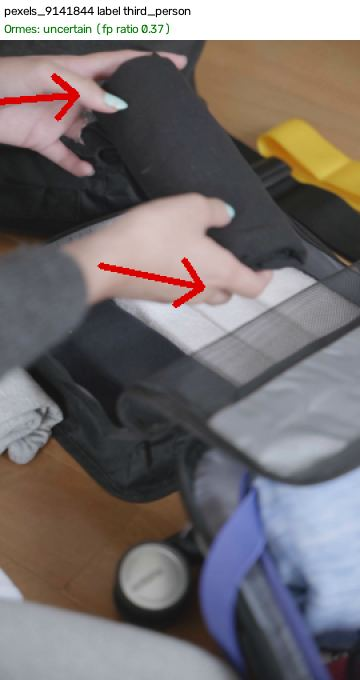
