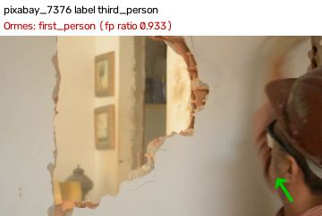
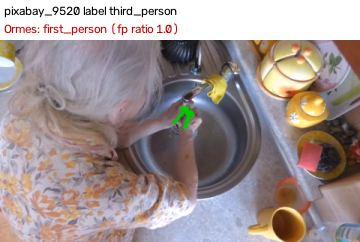

# Viewpoint check (#79)

run 39935528828 on `agent/viewpoint` (commit `d2e9d14`) · worker `viewpoint@0.3.0` applied to the stored features. Labels come from the sources (Egocentric-10K and HoloAssist are head-mounted; the Pexels clips are the founder's picks; Pixabay clips are labelled by eye from their contact sheets, founder veto on #79), never from Ormes. Constants fitted on `dev` only; `held_out` was not looked at while fitting. For now both a wrong viewpoint and `uncertain` send the video to review (the check cannot reject yet).

**First-person side:** after the veto only 1 Pixabay first-person clip is left, so the first-person numbers rely on HoloAssist and Egocentric-10K (head-mounted) and the founder's 4 Pexels picks; the third-person side is mostly Pixabay.

**Before:** Ormes had no viewpoint check: every third-person video went through as if first-person (third-person caught: 0%).

| split | first-person clips | called third-person (costly error) | uncertain (review) | third-person clips | called first-person (missed) | uncertain (review) | caught |
|---|---|---|---|---|---|---|---|
| dev | 65 | 0.00 [0.00-0.06] (0/65) | 0.14 [0.07-0.24] (9/65) | 33 | 0.03 [0.01-0.15] (1/33) | 0.52 [0.35-0.67] (17/33) | 0.45 [0.30-0.62] (15/33) |
| held_out | 27 | 0.00 [0.00-0.12] (0/27) | 0.15 [0.06-0.32] (4/27) | 30 | 0.03 [0.01-0.17] (1/30) | 0.53 [0.36-0.70] (16/30) | 0.43 [0.27-0.61] (13/30) |
| dev + held_out | 92 | 0.00 [0.00-0.04] (0/92) | 0.14 [0.08-0.23] (13/92) | 63 | 0.03 [0.01-0.11] (2/63) | 0.52 [0.40-0.64] (33/63) | 0.44 [0.33-0.57] (28/63) |

By source (all splits):

| source | label | clips | first-person | uncertain | third-person |
|---|---|---|---|---|---|
| egocentric10k | first_person | 60 | 51 | 9 | 0 |
| holoassist | first_person | 27 | 26 | 1 | 0 |
| pexels | first_person | 4 | 2 | 2 | 0 |
| pexels | third_person | 7 | 0 | 2 | 5 |
| pixabay | first_person | 1 | 0 | 1 | 0 |
| pixabay | third_person | 56 | 2 | 31 | 23 |

Every labelled clip:

| clip | split | label | verdict | first_person_ratio | hand frames | pointing up (median) | hand scale | face share | head share | still share |
|---|---|---|---|---|---|---|---|---|---|---|
| ego10k_factory001_worker001_00000 | dev | first_person | first_person | 0.897 | 29 | 0.98 | 0.161 | 0.0 | 0.0 | 0.013 |
| ego10k_factory001_worker001_00001 | dev | first_person | first_person | 0.8 | 45 | 0.96 | 0.144 | 0.0 | 0.0 | 0.0 |
| ego10k_factory002_worker001_00000 | dev | first_person | first_person | 0.959 | 49 | 0.952 | 0.169 | 0.0 | 0.0 | 0.038 |
| ego10k_factory003_worker001_00000 | dev | first_person | first_person | 0.98 | 50 | 0.905 | 0.172 | 0.0 | 0.0 | 0.038 |
| ego10k_factory004_worker001_00000 | dev | first_person | first_person | 0.928 | 69 | 0.967 | 0.238 | 0.0 | 0.0 | 0.025 |
| ego10k_factory005_worker001_00000 | dev | first_person | uncertain | 0.5 | 14 | 0.329 | 0.065 | 0.0 | 0.0 | 0.0 |
| ego10k_factory006_worker001_00000 | dev | first_person | first_person | 0.75 | 12 | 0.716 | 0.111 | 0.0 | 0.0 | 0.026 |
| ego10k_factory007_worker001_00000 | dev | first_person | first_person | 1.0 | 62 | 0.973 | 0.153 | 0.0 | 0.0 | 0.014 |
| ego10k_factory008_worker001_00000 | dev | first_person | first_person | 0.957 | 70 | 0.937 | 0.124 | 0.0 | 0.025 | 0.138 |
| ego10k_factory009_worker001_00000 | held_out | first_person | uncertain | 0.69 | 42 | 0.687 | 0.103 | 0.0 | 0.0 | 0.025 |
| ego10k_factory010_worker001_00001 | dev | first_person | uncertain | 0.667 | 9 | 0.985 | 0.087 | 0.05 | 0.0 | 0.0 |
| ego10k_factory010_worker001_00003 | dev | first_person | first_person | 1.0 | 76 | 0.865 | 0.176 | 0.0 | 0.0 | 0.113 |
| ego10k_factory011_worker001_00001 | dev | first_person | first_person | 1.0 | 60 | 0.991 | 0.17 | 0.0 | 0.0 | 0.013 |
| ego10k_factory011_worker001_00002 | dev | first_person | first_person | 1.0 | 62 | 0.985 | 0.151 | 0.0 | 0.0 | 0.025 |
| ego10k_factory012_worker001_00003 | held_out | first_person | first_person | 0.988 | 80 | 0.984 | 0.21 | 0.0 | 0.0 | 0.138 |
| ego10k_factory012_worker001_00009 | held_out | first_person | first_person | 0.974 | 77 | 0.923 | 0.211 | 0.0 | 0.025 | 0.212 |
| ego10k_factory013_worker001_00006 | held_out | first_person | first_person | 0.968 | 62 | 0.852 | 0.243 | 0.0 | 0.0 | 0.064 |
| ego10k_factory013_worker001_00008 | held_out | first_person | first_person | 0.94 | 50 | 0.873 | 0.256 | 0.0 | 0.0 | 0.026 |
| ego10k_factory014_worker001_00000 | held_out | first_person | first_person | 0.846 | 52 | 0.887 | 0.134 | 0.0 | 0.0 | 0.256 |
| ego10k_factory014_worker001_00007 | held_out | first_person | first_person | 0.987 | 76 | 0.944 | 0.192 | 0.0 | 0.0 | 0.0 |
| ego10k_factory015_worker001_00000 | dev | first_person | first_person | 0.758 | 62 | 0.667 | 0.215 | 0.0 | 0.0 | 0.215 |
| ego10k_factory015_worker001_00006 | dev | first_person | first_person | 0.899 | 69 | 0.966 | 0.248 | 0.0 | 0.0 | 0.177 |
| ego10k_factory016_worker001_00000 | held_out | first_person | uncertain | 0.962 | 26 | 0.888 | 0.149 | 0.0 | 0.275 | 0.0 |
| ego10k_factory017_worker001_00001 | held_out | first_person | first_person | 0.931 | 72 | 0.925 | 0.235 | 0.0 | 0.025 | 0.0 |
| ego10k_factory017_worker001_00002 | held_out | first_person | first_person | 0.806 | 72 | 0.862 | 0.198 | 0.0 | 0.0 | 0.1 |
| ego10k_factory018_worker001_00001 | dev | first_person | first_person | 0.983 | 59 | 0.971 | 0.207 | 0.0 | 0.0 | 0.113 |
| ego10k_factory018_worker001_00002 | dev | first_person | first_person | 0.981 | 52 | 0.926 | 0.201 | 0.0 | 0.0 | 0.013 |
| ego10k_factory019_worker001_00005 | dev | first_person | uncertain | 0.053 | 38 | -0.874 | 0.126 | 0.0 | 0.0 | 0.775 |
| ego10k_factory019_worker001_00006 | dev | first_person | uncertain | 0.059 | 51 | -0.922 | 0.104 | 0.0 | 0.0 | 0.887 |
| ego10k_factory020_worker001_00000 | dev | first_person | first_person | 1.0 | 54 | 0.866 | 0.175 | 0.0 | 0.0 | 0.039 |
| ego10k_factory020_worker001_00004 | dev | first_person | first_person | 1.0 | 80 | 0.954 | 0.178 | 0.0 | 0.0 | 0.062 |
| ego10k_factory021_worker001_00005 | dev | first_person | first_person | 0.972 | 72 | 0.926 | 0.258 | 0.0 | 0.0 | 0.113 |
| ego10k_factory021_worker001_00009 | dev | first_person | first_person | 0.967 | 60 | 0.95 | 0.141 | 0.0 | 0.0 | 0.038 |
| ego10k_factory022_worker001_00001 | dev | first_person | first_person | 0.971 | 68 | 0.921 | 0.189 | 0.0 | 0.0 | 0.0 |
| ego10k_factory022_worker001_00004 | dev | first_person | first_person | 0.986 | 74 | 0.892 | 0.18 | 0.0 | 0.0 | 0.013 |
| ego10k_factory023_worker001_00001 | dev | first_person | first_person | 1.0 | 79 | 0.948 | 0.211 | 0.0 | 0.0 | 0.138 |
| ego10k_factory023_worker001_00002 | dev | first_person | first_person | 0.988 | 80 | 0.963 | 0.214 | 0.0 | 0.0 | 0.138 |
| ego10k_factory024_worker001_00002 | dev | first_person | uncertain | 0.625 | 16 | 0.699 | 0.127 | 0.0 | 0.0 | 0.0 |
| ego10k_factory024_worker001_00006 | dev | first_person | first_person | 0.986 | 70 | 0.889 | 0.227 | 0.0 | 0.0 | 0.025 |
| ego10k_factory025_worker001_00001 | held_out | first_person | first_person | 1.0 | 71 | 0.877 | 0.249 | 0.0 | 0.0 | 0.138 |
| ego10k_factory025_worker001_00007 | held_out | first_person | first_person | 1.0 | 70 | 0.95 | 0.254 | 0.0 | 0.0 | 0.25 |
| ego10k_factory026_worker001_00000 | dev | first_person | first_person | 0.917 | 36 | 0.88 | 0.124 | 0.0 | 0.025 | 0.013 |
| ego10k_factory026_worker001_00003 | dev | first_person | first_person | 0.913 | 23 | 0.883 | 0.128 | 0.0 | 0.0 | 0.013 |
| ego10k_factory027_worker001_00000 | dev | first_person | first_person | 0.857 | 28 | 0.892 | 0.172 | 0.0 | 0.0 | 0.0 |
| ego10k_factory027_worker001_00006 | dev | first_person | first_person | 0.984 | 61 | 0.756 | 0.209 | 0.0 | 0.0 | 0.295 |
| ego10k_factory028_worker001_00003 | dev | first_person | first_person | 0.973 | 73 | 0.96 | 0.123 | 0.0 | 0.025 | 0.062 |
| ego10k_factory028_worker001_00008 | dev | first_person | first_person | 1.0 | 50 | 0.949 | 0.141 | 0.0 | 0.025 | 0.013 |
| ego10k_factory029_worker001_00000 | held_out | first_person | first_person | 0.92 | 25 | 0.965 | 0.174 | 0.0 | 0.0 | 0.0 |
| ego10k_factory029_worker001_00004 | held_out | first_person | first_person | 0.952 | 63 | 0.973 | 0.168 | 0.0 | 0.0 | 0.013 |
| ego10k_factory030_worker001_00001 | dev | first_person | first_person | 0.786 | 14 | 0.865 | 0.073 | 0.0 | 0.0 | 0.025 |
| ego10k_factory030_worker001_00004 | dev | first_person | first_person | 0.708 | 24 | 0.746 | 0.067 | 0.0 | 0.0 | 0.125 |
| ego10k_factory031_worker001_00000 | dev | first_person | first_person | 0.954 | 65 | 0.697 | 0.207 | 0.0 | 0.05 | 0.0 |
| ego10k_factory031_worker001_00001 | dev | first_person | first_person | 0.947 | 76 | 0.686 | 0.213 | 0.0 | 0.1 | 0.0 |
| ego10k_factory032_worker001_00002 | dev | first_person | first_person | 0.964 | 28 | 0.878 | 0.075 | 0.0 | 0.0 | 0.41 |
| ego10k_factory032_worker001_00003 | dev | first_person | uncertain | 0.591 | 22 | 0.703 | 0.071 | 0.05 | 0.0 | 0.241 |
| ego10k_factory033_worker001_00000 | held_out | first_person | first_person | 0.986 | 71 | 0.807 | 0.188 | 0.0 | 0.0 | 0.188 |
| ego10k_factory033_worker001_00002 | held_out | first_person | first_person | 1.0 | 79 | 0.818 | 0.193 | 0.0 | 0.0 | 0.212 |
| ego10k_factory034_worker001_00000 | dev | first_person | uncertain | 0.8 | 45 | 0.596 | 0.083 | 0.25 | 0.0 | 0.354 |
| ego10k_factory034_worker001_00002 | dev | first_person | first_person | 0.735 | 34 | 0.86 | 0.119 | 0.0 | 0.0 | 0.025 |
| ego10k_factory035_worker001_00006 | dev | first_person | first_person | 0.987 | 76 | 0.936 | 0.167 | 0.0 | 0.0 | 0.087 |
| holo_R077-21July-Nespresso | dev | first_person | first_person | 0.952 | 62 | 0.852 | 0.275 | 0.0 | 0.0 | 0.025 |
| holo_R089-27July-Coffee | dev | first_person | first_person | 0.893 | 28 | 0.863 | 0.363 | 0.0 | 0.0 | 0.025 |
| holo_R100-1Aug-Coffee | held_out | first_person | first_person | 0.867 | 60 | 0.944 | 0.218 | 0.0 | 0.0 | 0.087 |
| holo_R190-24Oct-ATV | held_out | first_person | first_person | 1.0 | 15 | 0.76 | 0.207 | 0.0 | 0.025 | 0.051 |
| holo_R196-25Oct-RAM | dev | first_person | first_person | 0.846 | 13 | 0.934 | 0.207 | 0.0 | 0.0 | 0.013 |
| holo_R201-7Nov-Belt | held_out | first_person | first_person | 0.875 | 16 | 0.944 | 0.199 | 0.0 | 0.0 | 0.013 |
| holo_z023-june-21-22-gladom_disassemble | dev | first_person | first_person | 0.973 | 74 | 0.892 | 0.231 | 0.0 | 0.025 | 0.063 |
| holo_z034-june-23-22-espresso | dev | first_person | first_person | 0.985 | 68 | 0.972 | 0.247 | 0.0 | 0.0 | 0.087 |
| holo_z035-june-23-22-gopro | held_out | first_person | first_person | 0.984 | 64 | 0.865 | 0.359 | 0.0 | 0.175 | 0.025 |
| holo_z035-june-23-22-marius_assemble | dev | first_person | first_person | 1.0 | 79 | 0.873 | 0.24 | 0.0 | 0.0 | 0.125 |
| holo_z036-june-23-22-knarrevik_assemble | dev | first_person | first_person | 0.933 | 60 | 0.965 | 0.282 | 0.0 | 0.025 | 0.037 |
| holo_z075-july-01-22-marius_disassemble | dev | first_person | first_person | 1.0 | 78 | 0.917 | 0.205 | 0.0 | 0.0 | 0.101 |
| holo_z090-july-08-22-espresso | held_out | first_person | first_person | 1.0 | 67 | 0.981 | 0.216 | 0.0 | 0.025 | 0.0 |
| holo_z092-july-11-22-knarrevik_disassemble | dev | first_person | first_person | 0.909 | 66 | 0.945 | 0.418 | 0.0 | 0.0 | 0.013 |
| holo_z093-july-11-22-knarrevik_assemble | held_out | first_person | first_person | 0.986 | 71 | 0.934 | 0.288 | 0.0 | 0.0 | 0.101 |
| holo_z096-july-12-22-knarrevik_disassemble | held_out | first_person | first_person | 1.0 | 75 | 0.923 | 0.223 | 0.0 | 0.0 | 0.037 |
| holo_z103-july-14-22-dslr | dev | first_person | first_person | 1.0 | 68 | 0.814 | 0.284 | 0.0 | 0.025 | 0.025 |
| holo_z125-aug-10-22-printer_big | dev | first_person | first_person | 0.891 | 46 | 0.923 | 0.206 | 0.0 | 0.0 | 0.0 |
| holo_z127-aug-10-22-switch | dev | first_person | first_person | 1.0 | 72 | 0.97 | 0.279 | 0.0 | 0.0 | 0.025 |
| holo_z155-aug-26-22-dslr | dev | first_person | first_person | 0.924 | 79 | 0.951 | 0.222 | 0.0 | 0.05 | 0.076 |
| holo_z155-aug-26-22-rashult_disassemble | dev | first_person | first_person | 0.922 | 64 | 0.907 | 0.185 | 0.0 | 0.0 | 0.0 |
| holo_z170-sep-03-22-gladom_disassemble | dev | first_person | first_person | 0.985 | 67 | 0.857 | 0.291 | 0.0 | 0.0 | 0.037 |
| holo_z179-sep-06-22-gopro | dev | first_person | first_person | 1.0 | 80 | 0.97 | 0.274 | 0.0 | 0.025 | 0.05 |
| holo_z197-sep-18-22-gladom_assemble | held_out | first_person | first_person | 0.984 | 63 | 0.901 | 0.241 | 0.0 | 0.0 | 0.037 |
| holo_z201-sep-22-22-rashult_assemble | dev | first_person | uncertain | 0.605 | 38 | 0.498 | 0.293 | 0.0 | 0.075 | 0.026 |
| holo_z202-sep-23-22-gladom_assemble | dev | first_person | first_person | 0.8 | 15 | 0.712 | 0.382 | 0.0 | 0.0 | 0.0 |
| holo_z204-sep-25-22-printer_small | dev | first_person | first_person | 0.778 | 27 | 0.93 | 0.176 | 0.0 | 0.0 | 0.141 |
| pexels_37443407 | dev | first_person | first_person | 1.0 | 48 | 0.737 | 0.346 | 0.0 | 0.0 | 0.562 |
| pexels_7204592 | held_out | first_person | first_person | 1.0 | 31 | 0.909 | 0.305 | 0.0 | 0.0 | 0.118 |
| pexels_7418650 | dev | first_person | uncertain | 0.371 | 89 | 0.368 | 0.296 | 0.0 | 0.0 | 0.273 |
| pexels_7658012 | held_out | first_person | uncertain | 0.647 | 17 | 0.782 | 0.088 | 0.0 | 0.0 | 0.712 |
| pixabay_10822 | held_out | first_person | uncertain | None | 0 | None | None | 0.0 | 0.0 | 0.646 |
| pexels_11102752 | held_out | third_person | third_person | 0.053 | 19 | -0.548 | 0.112 | 0.0 | 0.0 | 0.091 |
| pexels_4440711 | dev | third_person | uncertain | 0.636 | 11 | 0.725 | 0.201 | 0.0 | 0.0 | 0.444 |
| pexels_4520150 | dev | third_person | uncertain | 0.036 | 28 | -0.877 | 0.145 | 0.0 | 0.0 | 0.438 |
| pexels_5592524 | held_out | third_person | third_person | 0.0 | 50 | -0.243 | 0.223 | 0.059 | 0.0 | 0.03 |
| pexels_7308220 | held_out | third_person | third_person | 0.0 | 33 | -0.306 | 0.141 | 0.0 | 0.235 | 0.364 |
| pexels_7641501 | held_out | third_person | third_person | 0.291 | 55 | 0.079 | 0.094 | 0.0 | 0.0 | 0.069 |
| pexels_9141844 | dev | third_person | third_person | 0.25 | 48 | 0.041 | 0.154 | 0.0 | 0.0 | 0.071 |
| pixabay_1006 | dev | third_person | uncertain | 0.9 | 20 | 0.597 | 0.098 | 0.0 | 0.513 | 0.718 |
| pixabay_1108 | dev | third_person | third_person | 0.0 | 30 | -0.336 | 0.108 | 0.0 | 0.0 | 0.848 |
| pixabay_1111 | dev | third_person | third_person | 0.2 | 10 | -0.144 | 0.158 | 0.0 | 0.188 | 0.333 |
| pixabay_111832 | dev | third_person | third_person | 0.0 | 15 | -0.021 | 0.55 | 0.0 | 0.0 | 0.5 |
| pixabay_11290 | held_out | third_person | uncertain | 0.0 | 7 | -0.6 | 0.242 | 0.0 | 0.0 | 0.933 |
| pixabay_11291 | held_out | third_person | third_person | 0.0 | 83 | -0.125 | 0.196 | 0.0 | 0.0 | 0.659 |
| pixabay_11305 | held_out | third_person | third_person | 0.0 | 16 | -0.288 | 0.134 | 0.0 | 0.0 | 0.1 |
| pixabay_115790 | held_out | third_person | uncertain | 0.5 | 22 | 0.398 | 0.168 | 0.1 | 0.0 | 1.0 |
| pixabay_115792 | held_out | third_person | uncertain | 0.868 | 38 | 0.733 | 0.105 | 0.143 | 1.0 | 0.889 |
| pixabay_115793 | held_out | third_person | third_person | 0.071 | 42 | -0.464 | 0.177 | 0.0 | 0.032 | 0.65 |
| pixabay_11596 | dev | third_person | uncertain | 0.439 | 171 | 0.329 | 0.404 | 0.0 | 0.0 | 0.125 |
| pixabay_11597 | dev | third_person | uncertain | 0.396 | 134 | 0.169 | 0.376 | 0.0 | 0.0 | 0.191 |
| pixabay_11606 | dev | third_person | uncertain | 0.402 | 97 | 0.313 | 0.419 | 0.0 | 0.104 | 0.276 |
| pixabay_11638 | dev | third_person | uncertain | 0.514 | 181 | 0.35 | 0.419 | 0.0 | 0.0 | 0.181 |
| pixabay_143161 | held_out | third_person | third_person | 0.0 | 15 | -0.434 | 0.065 | 0.0 | 0.0 | 0.896 |
| pixabay_148542 | held_out | third_person | third_person | 0.25 | 48 | 0.043 | 0.068 | 0.759 | 0.0 | 0.632 |
| pixabay_150346 | held_out | third_person | uncertain | 0.0 | 4 | -0.51 | 0.106 | 0.0 | 0.0 | 0.186 |
| pixabay_150362 | held_out | third_person | uncertain | 0.0 | 48 | -0.744 | 0.143 | 0.0 | 0.0 | 0.828 |
| pixabay_150365 | held_out | third_person | uncertain | None | 0 | None | None | 0.0 | 0.0 | 0.97 |
| pixabay_150367 | held_out | third_person | uncertain | 0.0 | 3 | -0.889 | 0.053 | 0.0 | 0.0 | 0.212 |
| pixabay_150368 | held_out | third_person | uncertain | 0.0 | 8 | -0.458 | 0.035 | 0.0 | 0.0 | 0.0 |
| pixabay_166519 | dev | third_person | uncertain | 0.333 | 6 | -0.675 | 0.139 | 0.0 | 0.0 | 0.15 |
| pixabay_172686 | dev | third_person | uncertain | 0.778 | 27 | 0.625 | 0.104 | 1.0 | 0.846 | 0.176 |
| pixabay_175152 | dev | third_person | third_person | 0.045 | 22 | 0.136 | 0.162 | 0.0 | 0.0 | 0.525 |
| pixabay_177164 | held_out | third_person | third_person | 0.0 | 39 | -0.519 | 0.077 | 1.0 | 0.0 | 0.895 |
| pixabay_177412 | held_out | third_person | uncertain | 0.0 | 3 | 0.026 | 0.038 | 0.0 | 0.0 | 0.12 |
| pixabay_177415 | held_out | third_person | uncertain | 1.0 | 6 | 0.536 | 0.068 | 0.0 | 0.0 | 0.069 |
| pixabay_192743 | dev | third_person | uncertain | None | 0 | None | None | 0.0 | 0.0 | 1.0 |
| pixabay_19600 | held_out | third_person | third_person | 0.083 | 12 | -0.514 | 0.189 | 0.0 | 0.0 | 0.6 |
| pixabay_200157 | held_out | third_person | uncertain | 0.0 | 15 | -0.984 | 0.297 | 0.0 | 0.0 | 0.657 |
| pixabay_2339 | dev | third_person | third_person | 0.217 | 69 | 0.073 | 0.143 | 0.0 | 0.0 | 0.683 |
| pixabay_26366 | dev | third_person | uncertain | 0.0 | 43 | -0.933 | 0.177 | 0.0 | 0.0 | 0.053 |
| pixabay_263697 | held_out | third_person | uncertain | 0.368 | 87 | 0.0 | 0.044 | 0.14 | 0.0 | 0.786 |
| pixabay_263703 | held_out | third_person | uncertain | 0.323 | 62 | -0.805 | 0.045 | 0.037 | 0.0 | 0.157 |
| pixabay_322794 | dev | third_person | uncertain | 0.57 | 114 | 0.165 | 0.081 | 0.772 | 0.0 | 0.509 |
| pixabay_33742 | dev | third_person | third_person | 0.047 | 85 | -0.554 | 0.366 | 0.0 | 0.0 | 0.884 |
| pixabay_34091 | held_out | third_person | uncertain | 0.411 | 95 | -0.039 | 0.318 | 0.0 | 0.0 | 0.0 |
| pixabay_34537 | dev | third_person | third_person | 0.053 | 76 | -0.248 | 0.23 | 0.0 | 0.0 | 0.857 |
| pixabay_34541 | dev | third_person | third_person | 0.2 | 45 | 0.069 | 0.258 | 0.0 | 0.0 | 0.041 |
| pixabay_34772 | held_out | third_person | third_person | 0.025 | 40 | -0.287 | 0.298 | 0.0 | 0.065 | 0.274 |
| pixabay_34818 | dev | third_person | third_person | 0.038 | 26 | -0.282 | 0.393 | 0.0 | 0.02 | 0.566 |
| pixabay_35005 | dev | third_person | third_person | 0.156 | 77 | 0.151 | 0.384 | 0.0 | 0.0 | 0.385 |
| pixabay_35007 | dev | third_person | uncertain | 0.932 | 44 | 0.633 | 0.208 | 0.0 | 1.0 | 0.411 |
| pixabay_38115 | dev | third_person | third_person | 0.0 | 103 | -0.52 | 0.398 | 0.0 | 0.054 | 0.0 |
| pixabay_42040 | held_out | third_person | third_person | 0.167 | 18 | 0.108 | 0.348 | 0.0 | 0.091 | 0.377 |
| pixabay_42861 | dev | third_person | third_person | 0.05 | 20 | -0.299 | 0.186 | 0.0 | 0.0 | 0.783 |
| pixabay_43238 | held_out | third_person | uncertain | 0.481 | 160 | 0.371 | 0.037 | 0.0 | 0.0 | 0.154 |
| pixabay_43653 | held_out | third_person | uncertain | 0.2 | 5 | -0.581 | 0.186 | 0.0 | 0.0 | 0.423 |
| pixabay_51807 | dev | third_person | third_person | 0.0 | 178 | -0.506 | 0.383 | 0.0 | 0.049 | 0.515 |
| pixabay_5629 | dev | third_person | uncertain | 0.5 | 2 | -0.029 | 0.086 | 0.0 | 0.0 | 0.729 |
| pixabay_7376 | held_out | third_person | first_person **x** | 0.933 | 30 | 0.973 | 0.125 | 0.0 | 0.0 | 0.721 |
| pixabay_75700 | dev | third_person | uncertain | 0.25 | 4 | -0.285 | 0.193 | 0.0 | 0.031 | 0.238 |
| pixabay_83178 | dev | third_person | uncertain | 0.0 | 16 | -0.902 | 0.084 | 0.0 | 0.0 | 0.931 |
| pixabay_8702 | dev | third_person | uncertain | 0.0 | 29 | -0.903 | 0.138 | 0.0 | 0.0 | 0.329 |
| pixabay_9520 | dev | third_person | first_person **x** | 1.0 | 29 | 0.797 | 0.098 | 0.0 | 0.0 | 0.868 |
| pixabay_9631 | dev | third_person | third_person | 0.273 | 55 | 0.194 | 0.103 | 0.455 | 0.121 | 0.697 |

## Overlays

Green arrow: a hand pointing up the frame (wrist -> middle knuckle); red: not. Confident faces (as the privacy check counts them) are boxed.

